# toon-ui

A Compose Multiplatform UI kit in the look of golden-age theatrical cartoons: a thick ink outline of
variable weight, flat cel fills, hard offset shadows, and motion that squashes, overshoots and lands
in a puff of dust. Mobile first (Android, iOS), with desktop and wasm alongside. No Material
dependency.

<table>
  <tr>
    <td align="center">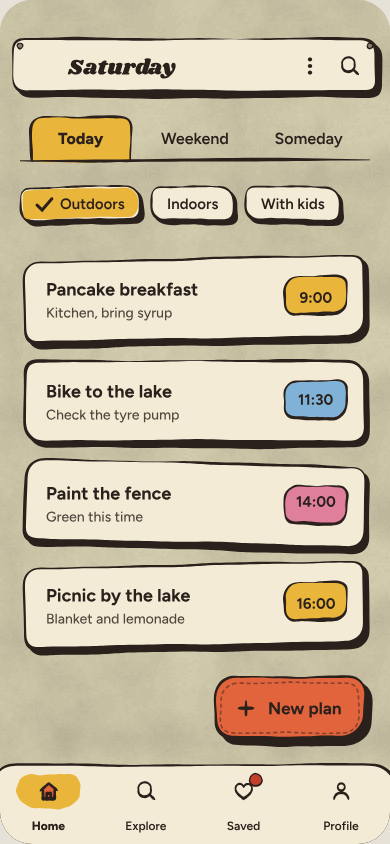</td>
    <td align="center">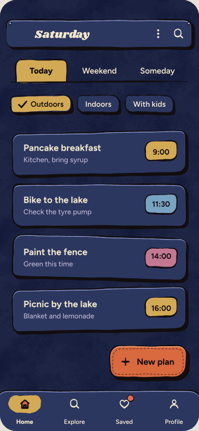</td>
    <td align="center">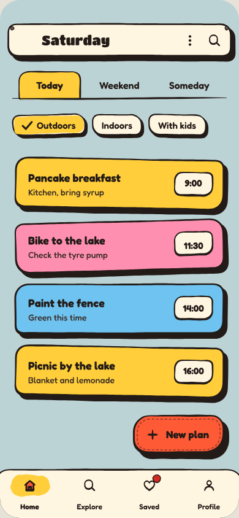</td>
  </tr>
  <tr>
    <td align="center"><b>Ink &amp; Gouache</b></td>
    <td align="center"><b>Night scene</b></td>
    <td align="center"><b>Bright Cel</b></td>
  </tr>
</table>

**[Try it in the browser →](https://youndie.github.io/toon-ui/)** Every component on one sheet,
under the three themes and reduce motion, and the three demo screens beside it.

All 27 components of the design are built, and four of the library's own besides: a list of cards,
a screen-transition host, a pull-to-refresh box that pulls its content, and the stage the rest stand
on. Each started from the design and is held to it twice: its geometry, frame by frame, against the
design's own drawing engine run in Node, and its pixels against references rendered from the design
in Chrome.

The code is primary, though, not the design. Where the running kit showed something the design gets
wrong — a seam under the tooltip's tail, a stripe across the menu's rolls, half the slider's rope
standing still in a drag, a line through the stage's texture — the component departs from it. Each
departure is a backlog item with its reason; where it changes a cell of the design, that cell is
listed, and the checks skip exactly the listed cells, so everything else is still the design's.

Every image here is a screenshot golden: the picture `./gradlew check` compares the code's render
against on every build. So it is what the library draws, not a mock-up.

## Components

<table>
  <tr>
    <td>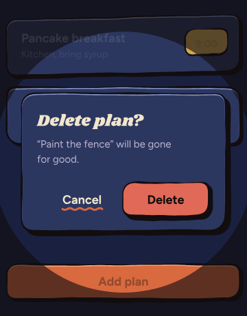</td>
    <td>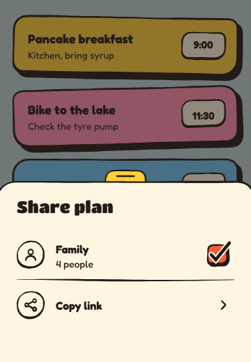</td>
    <td>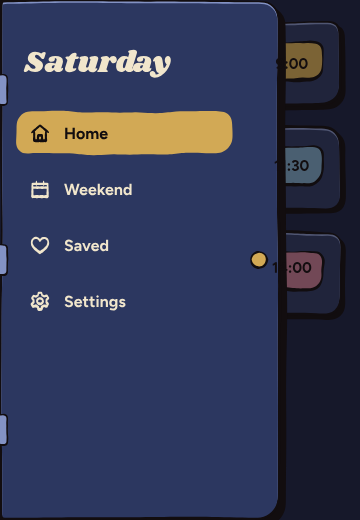</td>
  </tr>
  <tr>
    <td></td>
    <td colspan="2">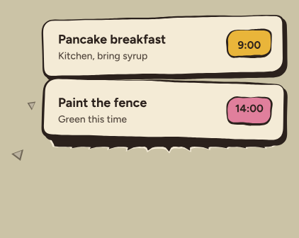<br>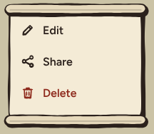</td>
  </tr>
</table>

[docs/components.md](docs/components.md) lists all of them: the design file, the engine's
renderer, and the goldens that show each.

## Motion

Curves are functions of elapsed time, ported from the design's engine, so the tests read them at
the design's own frame timestamps. A dialog opening, at 0, 60, 120, 200 and 400 ms:

<table>
  <tr>
    <td>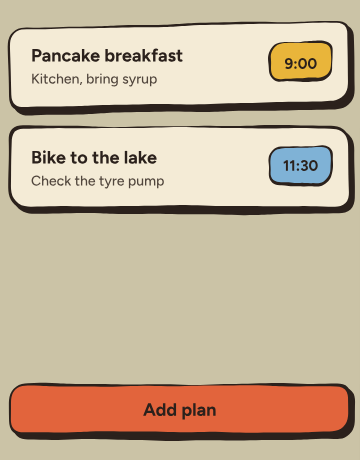</td>
    <td>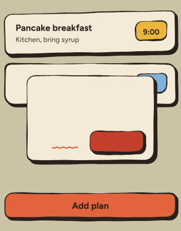</td>
    <td>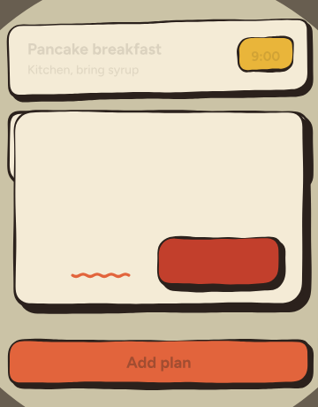</td>
    <td>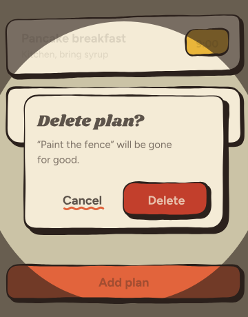</td>
    <td>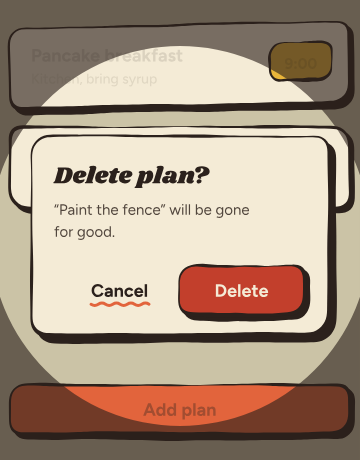</td>
  </tr>
</table>

Motion the design does not draw — a title card's looping rings, a chip making room for its tick, a
list closing up under the pull-to-refresh spinner — is tested at every millisecond for a jump, and
each such test is checked by a mutant that brings the jump back.

Reduce motion follows the design's word for each animation — a fade, a static spinner, or nothing —
rather than switching everything off.

## Using it

```kotlin
repositories {
    maven("https://reposilite.kotlin.website/snapshots") {
        mavenContent { includeGroupAndSubgroups("io.github.youndie") }
    }
}

dependencies {
    implementation("io.github.youndie:toon-core:0.1.0.<build>")
}
```

Every build of `main` publishes a version: `<head>.<build>`, where the head is the next release —
`0.1.0.<build>` now. The latest is the last `<version>` in
[maven-metadata.xml](https://reposilite.kotlin.website/snapshots/io/github/youndie/toon-core/maven-metadata.xml).
There is no release yet.

```kotlin
ToonTheme(ToonThemes.InkGouacheLight) {
    ToonStage {
        ToonFxHost {
            ToonButton("Add plan", onClick = {})
        }
    }
}
```

`ToonStage` paints the theme's backdrop and texture; `ToonFxHost` draws the dust, stars and speed
lines the components fire.

Targets: desktop (JVM), Android, iOS (arm64 and the arm64 simulator), and wasm.

The sample app, the kit and the demo screens in one window: `./gradlew :sample:run`.

## Where things are

[docs/](docs/README.md) holds the documentation. Start with the
[architecture research](docs/research/research-architecture.md), then the [backlog](backlog.md):
every change is an item there, with its cause, its decision and the alternative it rejected. The
design is vendored, unedited, in [reference/design-system/](reference/design-system/), and the
departures from it are listed in
[`ToonDepartures`](toon-core/src/desktopTest/kotlin/io/github/youndie/toon/parity/ToonDepartures.kt).

## Licence

- **The code** is under the MIT License ([LICENSE](LICENSE)).
- **The bundled fonts** are under the SIL Open Font License 1.1. Their full texts are in
  `toon-core/src/commonMain/composeResources/files/licences/`.
